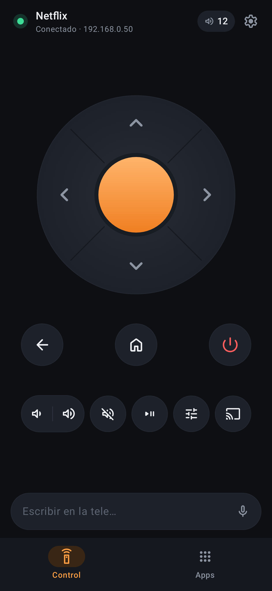

# Control TV

Control remoto propio para el Chromecast con Google TV. Habla directo con la tele por Wi‑Fi
(protocolo Android TV Remote v2, puertos 6467 y 6466), sin servidor.

## Compilar e instalar

1. Abrí la carpeta `control-tv` en Android Studio (está en el menú Inicio).
2. Conectá el celu con la depuración USB activada y apretá Run (▶).

Sin Android Studio, desde una terminal:

```
gradlew assembleDebug        → app/build/outputs/apk/debug/app-debug.apk
gradlew testDebugUnitTest    → pruebas + capturas de pantalla
```

## Probar sin la tele

`gradlew testDebugUnitTest` corre 34 pruebas:

- **ProtocolTest**: bytes exactos de cada mensaje, el secreto de vinculación y el certificado.
- **FakeTvTest**: una tele de mentira con TLS de verdad (`FakeTv.kt`). Prueba la vinculación con el
  código, el código mal tipeado, la sesión de control (teclas, texto, apps, ping, volumen),
  el celu desconocido, la huella cambiada, la reconexión y que muchos reinicios seguidos no
  dejen sesiones abiertas de más.
- **ScreenshotTest**: genera las capturas de `docs/diseno/` (quedan en `app/build/outputs/roborazzi/`).

## Diseño

Oscuro, porque se usa de noche frente a la tele: fondo grafito y un solo color de acento, ámbar.

| | |
|---|---|
| Fondo / superficies | `#0D0F13` · `#15181E` · `#1D2129` |
| Acento (OK, enviar, selección) | `#FF9F45` |
| Conectado / error | `#3DDC97` · `#FF5E5E` |

- **Control**: línea de estado arriba (punto de conexión, app en pantalla, volumen, Ajustes).
  En el medio, el pad circular con el OK ámbar como protagonista; abajo, Atrás · Inicio ·
  Encendido y, más abajo, volumen · silencio · play/pausa. La barra de texto queda cerca del
  pulgar y del teclado. Si el teclado ocupa la pantalla, se esconden las filas y queda el pad.
- **Apps**: grilla de tarjetas con inicial de color. La app abierta en la tele se marca en ámbar,
  y arriba aparece "En pantalla" con el botón para agregarla.
- **Vinculación**: dos pasos (IP y código), con el código en 6 casillas grandes.



Las 13 pantallas están en [docs/diseno](docs/diseno).

## Cómo se comportan los botones

- Las flechas, el volumen y borrar se repiten al mantenerlos apretados (manda toques seguidos).
- OK, Atrás e Inicio hacen pulsación larga en la tele (`START_LONG` → `END_LONG`): por ejemplo, el menú contextual.
- Encendido y play/pausa no tienen pulsación larga, para no apagar la tele sin querer.

## Diferencias con el plan

- **Protobuf a mano** (el plan B del plan): `tv/Proto.kt` (el codificador, ~130 líneas) y `tv/Messages.kt` (los mensajes).
  Así no se depende del plugin de protobuf con AGP 9, que es nuevo, y hay una dependencia menos.
  Los `.proto` siguen en `app/src/main/proto` como referencia de los números de campo.
- **Flechas que se repiten** mandando toques cortos seguidos, en vez de `START_LONG`/`END_LONG`:
  así el desplazamiento por listas anda seguro.
- **"Hay que vincular de nuevo"**: si la huella de la tele no coincide, se pide enseguida. Si la
  tele corta el TLS, se espera a 3 cortes seguidos: según el momento, el rechazo llega como alerta
  TLS o como "conexión abortada", y así un corte casual no manda a vincular sin motivo.
- El volumen se ve solo en la línea de estado (el balancín no lo repite). Si la tele no informa
  un nivel (por ejemplo, el Chromecast manejando el volumen de la tele por HDMI manda `0/0`),
  no se muestra ningún número.
- **Enter después del texto, solo con un campo abierto**: si la tele no avisó un campo de texto,
  el texto se manda igual pero sin Enter, porque el Enter "tocaría" lo que esté seleccionado
  en pantalla (en la prueba real abrió Prime Video desde Inicio).

## Probado con la tele real

13/11/2026 · Chromecast con Google TV en una tele Sony · Galaxy S25 Ultra con Android 17.

| Qué | Resultado |
|---|---|
| Permiso de red local (Android 17) | ✅ |
| Vinculación con el código | ✅ |
| Conexión, pings y reconexión al volver a la app | ✅ |
| Flechas, OK, Atrás, Inicio, borrar y Enter | ✅ |
| Volumen, silencio y play/pausa | Salen sin errores; falta verlos en pantalla |
| Abrir apps por link (YouTube) | ✅ |
| Texto al enviar, en el buscador de Google TV | ✅ |
| Texto en vivo (letra por letra y borrados) | ✅ |

Lo que se aprendió:

- La tele avisa un campo de texto abierto con `ime_key_inject` y contadores distintos de 0, y
  después de cada cambio manda `ime_show_request` con el contador de campo nuevo.
- Sin campo abierto, los contadores llegan en 0 y el texto se ignora.
- Hay un mensaje que no figura en los `.proto` de referencia (campo 24). El log muestra sus bytes
  para poder descifrarlo.
- Falta probar el resto de los links de la lista de apps y el encendido.

Si algo falla, Ajustes → Log de conexión muestra cada mensaje que va y viene, y se puede copiar.
